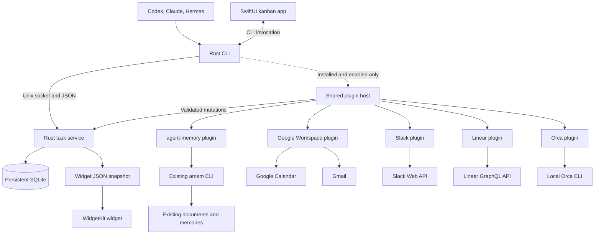

# Architecture

The Rust service owns task writes. The CLI and SwiftUI app use the same request contract. The widget reads a compact database-derived snapshot. Core tasks and subtasks work without plugins; integrations run only through separately installed, enabled packages.

## Components

## Sources of truth

| Data | Source | Derived data |
| --- | --- | --- |
| Tasks, hierarchy, runs, assignments, events | Persistent board SQLite database | Widget JSON, exported lists |
| Artifacts and task documents | Existing project files or user-created documents | Previews and search displays |
| Optional long-term memory | Reviewable vault files in existing agent-memory | amem search indexes |
| External evidence | Canonical files and URLs | Search snippets and temporary references |

Obsidian neither owns the source data nor serves as a runtime dependency. Markdown descriptions and outcomes can be read in Obsidian. Even when documents are stored in a selected vault, task state remains in SQLite. Moving task state to Markdown would require a separate storage decision.

Never store the board database or widget snapshot in `amem/.state`. That directory contains rebuildable document and memory indexes. Manage persistent task storage and backups independently.

## Plugin boundary

The core creates/searches tasks and subtasks, assigns work, resumes runs, attaches artifacts, backs up, and exports without plugins. Ordinary file and URL attachments require no external integration identifiers.

The core distribution includes only the shared extension boundary. Ship integration executables, libraries, and runtimes separately. Uninstalled or disabled plugins do not load/execute code, discover executables, access accounts, synchronize, or run background work. The core build and runtime require neither Python nor an email account.

Plugins modify tasks only through the service contract. They neither write the database directly nor create another task source of truth. The service applies the same assignment, revision, and retry-ID checks as core operations.

Apply timeouts and report failures within the affected feature. Never hold a database write transaction during an external call. Disabling or removing stops new calls and background work and manages in-flight termination. Validate late results so disabled plugins cannot apply further mutations. Preserve tasks, artifacts, and evidence links.

The shared contract defines plugin IDs, versions, compatibility, capabilities, and permissions. Reject incompatible plugins before execution. Version 1 uses local executable packages, manifests, and standard-input/output JSON. Processes isolate execution; a journal freezes prepared mutation results. See the [plugin package contract](cli-contract.md#plugin-package-contract). Verify failure isolation instead of loading external code directly into the core process.

Google Workspace centers on Calendar deadlines and meetings, with optional Gmail. Preserve event start/end, time zone, source ID, and version. Use deterministic event IDs for creation and ETags for updates. Do not overwrite either side automatically: the user chooses the direction. See [Google Workspace](google-workspace.md) for authentication, permissions, retries, and conflicts.

Due dates and schedules remain core task data. Personal planning works without Google. Keep themes and display settings separate from task state in app preferences.

agent-memory invokes amem only after installation, enabling, and an explicit request. See [agent-memory](agent-memory-integration.md) for scoped searches, source verification, and explicit memory capture.

Slack separates search results from source reads and rechecks source versions immediately before attachment/import. Status sending is enabled separately and uses the latest task read by the host from the service. The shared journal reuses completed sends and prevents automatic resending after uncertain outcomes. See [Slack](slack.md).

Linear follows the same read, recheck, and attach pattern for issues. Status comments and state changes are enabled separately and use the latest task read by the host. Comments use an ID derived from the issue and task revision, so a new request cannot post the same status twice. State changes require the version from the last read and refuse issues that changed since. See [Linear](linear.md).

Orca queries the configured local repository's worktrees and terminals through its CLI. Record assignment and a run first; launch with host-verified current task/run data. Per-run external journals prevent duplicate terminals and refuse uncertain relaunches. Link created terminals to board runs. Saved attachment requests and plugin-scoped `idempotency_key` values recover the attachment once after host interruption. Terminal exit does not complete the task. See [Orca](orca-integration.md).

## State transitions

1. The client supplies a request ID and target revision.
2. The service checks format, current state, and assignment conditions.
3. One transaction records task mutations, events, and the processed request ID.
4. Responses and history include the committed event sequence.
5. Generate a widget snapshot containing that sequence.

Retries with identical request IDs return the original result. Stale revisions produce conflicts. Conditional assignment prevents simultaneous claims by multiple agents.

The service validates parent/subtask changes in the same database. A task cannot name itself or a descendant as its parent. Subtasks follow ordinary task status and assignment rules; parent completion counts are derived from their relationships and statuses.

Record claim expiration and last activity, but do not complete tasks merely because time elapsed. Check the previous run before reassigning work.

## Service and transport

Run the service as a current-user LaunchAgent. The local installer registers it and takes over an existing manual service. App registration/status management through SMAppService remains separate work. Create the Unix socket in a private directory and verify peer identity and ownership.

The contract includes protocol version, request ID, method, parameters, and structured errors. Specify framing, size limits, and timeouts. The app reloads a snapshot on reconnect. The CLI can read events after a sequence. Do not expose database internals to clients.

## App and widget refresh

The active SwiftUI app polls the board snapshot every second and preserves UI state when the event sequence is unchanged. The menu bar shares this state. WidgetKit reads App Group JSON. Complete a temporary snapshot and atomically replace the destination to avoid partial JSON reads.

Snapshots contain format version, sequence, generation time, and task display data. On generation failure, keep the previous timestamp and expose staleness. Database commit and snapshot publication are separate; compare sequences and recover on service restart.

macOS controls actual widget refresh timing. WidgetKit accepts reload requests only from the containing app. After writing the shared snapshot, the service runs that app's executable with `--reload-widgets`. This mode requests a reload without showing a window, then exits. Changes arriving during execution are coalesced into one additional run. CLI changes can therefore reach the widget with the app window closed. The widget also rereads after five minutes and updates at midnight and staleness boundaries.

The Swift host persists the App Group path through `widget.configure`. The service writes both its default snapshot and configured shared snapshot and retains this setting across restart. macOS app data protection can reject a background service writing into another app's group container by path alone, without displaying a consent prompt. Before writing, the signed service resolves the container through Foundation's `containerURLForSecurityApplicationGroupIdentifier:` to obtain authorized access.

## Resumable context

Tasks retain goals, completion criteria, and next actions. Runs identify agent types, timestamps, artifacts, and interruption reasons. Host-specific resume IDs are supplementary, never the only way another agent can understand work.

Keep the goal, artifacts, and next action in the board itself so work remains resumable without agent-memory.

Search memory only on request after enabling the integration. Do not place entire document/memory collections into every task context. Link the original locations of relevant evidence. On resume, reverify only when requested and the integration is enabled. Otherwise show the last verified metadata and source links.

## References

- The external amem project's `docs/architecture.md`.
- [SQLite WAL](https://sqlite.org/wal.html)
- [SMAppService](https://developer.apple.com/documentation/servicemanagement/smappservice)
- [App Groups](https://developer.apple.com/documentation/xcode/configuring-app-groups)
- [WidgetKit refresh](https://developer.apple.com/documentation/widgetkit/keeping-a-widget-up-to-date)
