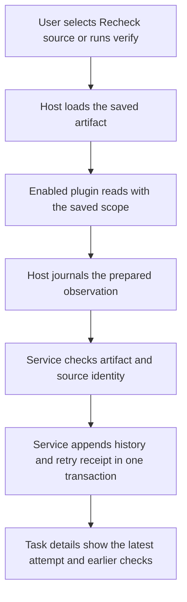

# Memory Evidence Verification Follow Up

Implemented November 1, 2026, on top of source revision `02b0608586de5b8e011b3daf2224991174585b1a`. This replaces the proposed Workboard persistence work in the source plan with implementation and verification evidence. Agent Memory continuity evaluation and native capture retry protection remain separate work.

Explicit source rechecks now append observations to the board. The original attachment, source hash, verification time and attachment reason remain historical evidence. A failed recheck signals that the source needs review before reuse; it does not invalidate all work that previously cited it.

## Implemented flow



Only an installed, enabled plugin reads the external source. Displaying saved history requires no executable discovery, account access, source read or synchronization. Slow checks use a separate app client so ordinary task operations remain available.

| Result | Saved and displayed meaning |
| --- | --- |
| `current` | The observed path, collection and hash matched at the recorded check time. |
| `changed` | A readable source had a different path, collection or hash. Review before reuse. |
| `unreadable` | The saved reference could not be read. It may have expired; this does not establish deletion. |
| `integration_failure` | The executable or plugin could not complete the check. There is no source verdict. Earlier source verdicts remain visible. |

Memory index freshness and upstream factual freshness remain separate. Matching a local hash does not prove that a linked service, release or PR still has the same status.

## Storage and retry rules

Database version 9 adds `evidence_verifications`, linked to the task and artifact. Each record includes its request ID and payload fingerprint, actor, normalized observation time, service recording time, original source identity and scope, status, observed identity/hash when readable, and a diagnostic of at most 2,000 characters.

`artifact.verification.record` uses the existing service mutation contract. Validation, task revision, the history insert, event and retry receipt commit together. A repeated request reuses its result; a different payload under that ID conflicts. A late observation must still match the original artifact's task, path, provider, locator, ref, collection, source hash and scope. Ordinary task edits do not silently redirect it to another attachment.

History reads sort by observation time, with service insertion order breaking ties. A late older check cannot displace a newer observation. Replacing evidence creates a new attachment with optional `metadata.supersedes_artifact_id`; the service checks that the earlier attachment belongs to the same task. Old checks stay with the earlier attachment.

Backups contain history and retry receipts. Restoring older backups migrates a private copy without changing the input backup. JSON and Markdown exports include the full verification history. Trash preserves it; explicit permanent deletion removes linked rows and retains their data in the deletion event, following the existing deletion contract.

## CLI and app use

These commands are implemented with agent-memory plugin 0.2.0:

```sh
workboard plugin run agent-memory verify --params '{"task_id":"TASK_ID","artifact_id":"ARTIFACT_ID"}'
workboard rpc artifact.verification.list --params '{"task_id":"TASK_ID","artifact_id":"ARTIFACT_ID"}' --json
workboard task show TASK_ID --json
```

The host supplies the saved artifact rather than trusting caller-supplied source fields. Use a new request ID for each new observation. Retrying an existing ID replays that observation instead of reading again.

Task details provide **Recheck source**, the latest attempt and its time, original metadata, and expandable check history. A failed attempt also shows the last available source verdict. Check details include observation and recording times to the second, actor, diagnostic, and observed identity/hash. Disabled integrations retain this display. Older plugin packages show an update hint.

Upgrade instructions and result semantics are in the [integration guide](agent-memory-integration.md#durable-links). The generic host and service fields are documented in the [CLI contract](cli-contract.md#plugin-package-contract).

## Verification evidence

All fixtures use disposable boards and synthetic sources. They do not access the user's memory index or accounts.

| Check | Evidence |
| --- | --- |
| Persistence, retry conflicts and restart | Rust tests `evidence_history_survives_restart_retry_backup_and_exports` and `version_eight_migration_and_backup_keep_original_evidence`. |
| Original hashes and replacement history | Rust `evidence_replacement_and_late_results_keep_the_original_generation`; actual CLI/host/service test `test_rechecks_replay_once_survive_restart_and_preserve_original_and_replacement`. |
| Late observations, source verdict validation and trash | Rust `evidence_history_orders_by_observation_and_distinguishes_failed_attempts`. |
| Active automation and final approval | Rust `evidence_checks_preserve_active_automation_and_final_approval` confirms that an evidence check does not fence an active stage or revoke approval readiness. |
| Host-read scope and task membership | Actual host tests reject foreign artifacts before any external read and replace forged caller source fields with saved data. |
| Missing executable, host timeout and invalid input | Actual host tests save failed execution attempts without observed identity, while rejecting invalid evidence without inventing an execution failure. |
| Malformed provenance and scope | Plugin checks reject malformed saved scopes before execution and classify unparseable source headers as integration failures without a source verdict. Legacy metadata-only provider fields remain supported. |
| Disabled plugin, backup, restore and export | Actual host test preserves history and confirms no additional fake-executable calls. |
| App models | Swift workflow regression checks source separation, chronological history and failure labels. |
| Presentation | Light and dark SwiftUI pixel renders use four saved observations from an actual isolated service. These are rendered views, not captured running-app windows. |

`python3 scripts/verify.py --scope all` passed: 123 Rust tests, 316 Python checks, nine installer checks, the Swift build and three Swift regression runners, English-only source checks, and WidgetKit compilation. Final focused reruns passed 124 Rust tests (including the added automation regression), Clippy with warnings denied, six host checks and 26 memory plugin checks. The extra focused plugin checks cover the final provenance/scope and legacy-provider refinements.

Rendered presentation evidence: [light](images/memory-evidence-light.png), [dark](images/memory-evidence-dark.png). Both views show the original source and four saved observations: matched, changed, unreadable and integration failure.

Native click automation remains unverified on this Mac: the computer-use tool returned `cgWindowNotFound` for the separately identified preview app. Only Command Line Tools are installed, so the XCUITest runner cannot run here. Actual amem reindexing is outside the synthetic-executable checks and has not been rerun for this change. The earlier real-amem evidence remains documented in the integration guide.

Related source-plan Inbox item: `021f4c73-a624-43fa-95d8-1052d1e4848b`. Implementation review task: `6b2003e3-0891-4f11-9ab8-a23a88c2e9e6`.
