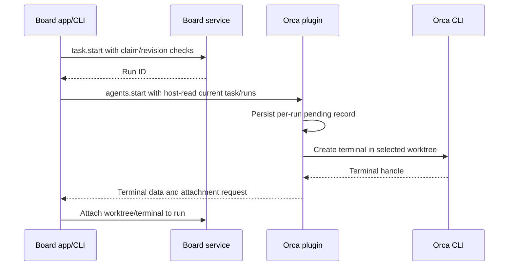

# Orca plugin

Browse local Orca worktrees/terminals, import a selected worktree as a task/subtask, attach it to existing work, or launch Codex/Claude in an Orca terminal. Only the board service changes task data.

The optional plugin requires Orca app/CLI and Python 3. The core contains neither provider code nor Python. Installation leaves it disabled. Launches require a current board build supporting host-provided `task_runs` and `board_connection`.

## Installation and app workflow

```sh
scripts/package-plugins.sh
unzip dist/AgentWorkboard-plugin-orca-0.2.0.zip -d /tmp/workboard-orca
workboard plugin install /tmp/workboard-orca/orca-0.2.0
workboard plugin enable orca --executable /path/to/orca \
  --config '{"repos":["path:/path/to/first-repo","path:/path/to/second-repo"]}'
workboard plugin check orca --json
```

Replace the executable with an absolute Orca CLI path. No automatic executable discovery. `repos` lists the connected Orca repositories, at most 50, as `id:…`, `path:…`, or `name:…` selectors. The plugin resolves them with one `orca repo list` call: `path:` matches the repository folder after resolving symbolic links, and a `name:` that matches several repositories connects none of them. The earlier single `repo` setting still works and counts as one more entry. `check` returns the connected `repos` and the `unmatched` selectors with a reason; it fails only when no selector matches. Every other method works only with worktrees of connected repositories. Only local repositories/worktrees on this Mac are supported; remote environments and Orca orchestration Run task synchronization are not.

To work by board project, connect the repository at each project's folder. In the app, **Configure and enable** fills in `path:` entries for the board project folders when no repository is set, and **Add board project folders** adds them later.

In **Settings → Plugins → Install**, select the extracted directory. **Configure and enable** accepts the executable and repositories. Choose **Use** and a worktree:

| Feature | Behavior |
| --- | --- |
| Browse | Show worktrees of all connected repositories grouped by repository, or of one chosen repository, with branches and workspace status; separately load run terminals and connection state. Selectors not found in Orca are listed. |
| Import | Create a task in the selected project, or a subtask of the selected board task. Selecting a worktree preselects the board project whose folder is its repository. |
| Attach | Save worktree path, source ID/instance, branch, commit, and verification time. |
| Launch | Run the selected task with Codex/Claude and optional extra instructions. A note appears when the worktree is not in the folder of the task's project. Agent installation/authentication follows that CLI's settings. |
| Output | Explicit **Read output** reads up to 200 lines. Lists omit terminal previews and draft input. |

Imports start in To do. Orca `done` and terminal exit do not complete board work. Do not overwrite existing goals, assignees, or criteria from external status. Observations are point-in-time, not automatic sync.

## CLI workflow

Replace uppercase IDs with actual values. `WORKTREE_ID` is the complete `id` from `worktrees.list`. Each worktree includes `repo_id`, `repo_name`, and `repo_path`.

```sh
workboard plugin run orca worktrees.list --json
workboard plugin run orca worktrees.list --params '{"repo_id":"ORCA_REPO_ID"}' --json
workboard plugin run orca worktrees.get --params '{"worktree_id":"WORKTREE_ID"}' --json
workboard plugin run orca worktrees.import --request-id IMPORT_REQUEST_ID \
  --params '{"worktree_id":"WORKTREE_ID","project_id":"BOARD_PROJECT_ID","parent_id":"PARENT_TASK_ID"}' --json
workboard plugin run orca worktrees.attach --task TASK_ID \
  --params '{"worktree_id":"WORKTREE_ID","expected_revision":REVISION}' --json
workboard plugin run orca terminals.list --params '{"worktree_id":"WORKTREE_ID"}' --json
workboard plugin run orca terminals.read \
  --params '{"worktree_id":"WORKTREE_ID","terminal":"TERMINAL_HANDLE","limit":80,"cursor":0}' --json
```

Include `parent_id` only for subtasks. Replace `REVISION` with the current integer. Identical import request IDs/parameters reuse tasks/attachments; new request IDs create separate tasks.

Create a board run before launching. Pass its returned `run_id`:

```sh
workboard rpc task.start --request-id START_REQUEST_ID \
  --params '{"task_id":"TASK_ID","agent_id":"orca:codex","expected_revision":REVISION}' --json
workboard plugin run orca agents.start --task TASK_ID --request-id LAUNCH_REQUEST_ID \
  --params '{"worktree_id":"WORKTREE_ID","run_id":"RUN_ID","agent":"codex","prompt":"Additional instructions"}' --json
```

For Claude, use assignee `orca:claude` and agent `claude`. Reject new terminals for another assignee or an obsolete run. A successful previous launch may recover only its existing result/attachment. The app uses the same two stages and reuses the current run when appropriate.



The agent receives goals, criteria, next action, board CLI/data/socket paths, and the shared [agent protocol](../integrations/agents/protocol.md). The terminal command sets `WORKBOARD_AGENT=orca:<agent>`, `WORKBOARD_DATA_DIR`, and `WORKBOARD_SOCKET`, so the agent's board commands act as the run's assignee on the same board. The review command uses `task review --run` instead of a raw request. Quote the prompt as one shell argument. Instruct it to reread current work, record verification and next actions, and request review instead of completing merely because its response ended.

Default agent commands are `codex` and `claude`. Override paths/options through `agent_commands`; array elements are literal arguments and the prompt is appended last. Shell pipelines/command strings are not accepted.

```json
{"executable":"/path/to/orca","repos":["id:ORCA_REPO_ID"],"agent_commands":{"codex":["/path/to/codex"],"claude":["/path/to/claude"]}}
```

## Failures and retries

The same board run ID never creates another terminal, even with a new top-level request ID. To change worktree/instructions, inspect the old run and create a new one. Do not delete plugin `launches` records to retry.

Success records retain the board attachment request. If the host stops after terminal creation, a new request for the same run recovers that attachment. Per-run `idempotency_key` makes concurrent recovery apply it only once. Even if task contents changed or another run started, recover only the historical link without overwriting current goals/run state.

Persist pending before terminal creation. Timeout/interruption with an uncertain outcome blocks relaunch. Inspect `Workboard RUN_ID` in Orca. Failed external creation still leaves the board run as an attempt record. Use `task.pause` to record blocking reasons/next actions if needed. Check existing agents before starting another run.

Disabling/removing stops later calls and preserves tasks/subtasks/runs/links. Already launched Orca terminals/agents may continue; inspect and stop them in Orca. Integration errors do not fail core doctor.

## Verification

`python3 tests/test_orca_plugin.py` combines fake Orca executables with a real board service to verify repository scope across several connected repositories, unmatched and ambiguous selectors, the earlier single-repository setting, provenance, subtasks, request retries, claims/revisions, concurrent launch deduplication, uncertain outcomes, timeouts, and preservation after disable/remove.

An installed Orca runtime was also checked with an isolated board: repository/worktree/terminal reads, import, a `/usr/bin/true` test terminal, retry, and run attachment. The created terminal was closed. This does not verify actual Codex/Claude authentication, paid model calls, or native app buttons.
